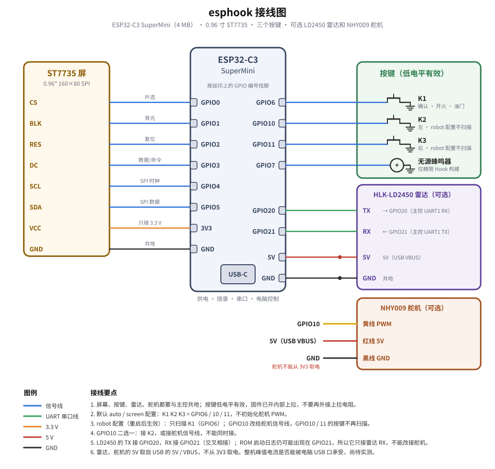

# esphook

一块 **ESP32-C3 + 0.96 寸 ST7735 小屏** 的桌面小玩意：开机是“新婚快乐”彩带屏，菜单里有 20 多个应用和小游戏（电子木鱼、水族箱、投篮、赛车、飞船、僵尸围城……），可以接雷达和舵机做成会转头的机器人，也可以当 Claude Code / Codex / Kimi Code / Cursor Agent 的提醒屏。所有应用共用一套[应用框架](docs/app-framework.md)，新增一个应用只要一份 manifest 和一个 C 文件。

| 想做什么 | 去哪里 |
| --- | --- |
| 把固件刷进板子 | [1. 烧录固件](#1-烧录固件) |
| 知道线怎么接 | [2. 接线（原理图）](#2-接线原理图) |
| 开机后怎么用、有哪些应用 | [3. 第一次开机与操作](#3-第一次开机与操作)、[4. 内置应用](#4-内置应用) |
| 用电脑玩 / 控制板子 | [5. 连接电脑](#5-连接电脑) |
| 当 Agent 提醒屏 | [6. Agent Hook](#6-agent-hook) |
| 让 AI Agent 帮我刷机、配置、写应用 | [用 AI Agent 上手](#用-ai-agent-上手)、[Agent 上手指南](docs/ai-agent-guide.md) |
| 写应用、构建、测试 | [7. 开发](#7-开发) |
| 查所有文档 | [8. 文档索引](#8-文档索引) |

**需要的硬件**：ESP32-C3 SuperMini（4 MB Flash）、0.96 寸 160×80 ST7735 SPI 屏、一个按键（K1，建议三个）、USB-C 数据线。雷达（LD2450）和舵机（NHY009）是可选的，没有它们所有应用照样能玩。

---

## 用 AI Agent 上手

仓库自带给 AI Agent 的说明（[AGENTS.md](AGENTS.md)、`CLAUDE.md`）和五个项目 skill，Claude Code、Codex、Cursor 等能自己读懂项目、刷机、配置、写应用和跑测试，你只要说想做什么：

1. 拿到代码：`gh release download -R Ken-u/esphook -p esphook-kit.zip -p SHA256SUMS` 后解压（已经带固件，可以直接刷），或者 `git clone` / fork 本仓库。
2. 用 USB-C 数据线接上板子，在这个目录里启动你的 Agent（Claude Code、Codex、Cursor 都行）。
3. 对它说，例如：
   - “帮我把固件刷到板子上，再把时间校准一下。”
   - “我接了舵机但没反应，帮我看看怎么回事。”（它会指导你切到机器人配置，**但不会自己让舵机转动**。）
   - “屏幕颜色反了，帮我调一下。”
   - “做一个贪吃蛇小游戏，K1 转向，要有最高分。”
   - “把我的 Claude Code 完成提醒接到这块屏上。”

| skill | 管什么 |
| --- | --- |
| `esphook-device` | 刷固件、读状态、打开应用、硬件/时间/屏幕/舵机配置 |
| `esphook-hook` | Wi-Fi、daemon、配对、Agent Hook |
| `esphook-app` | 写设备应用和小游戏 |
| `esphook-pc` | PC 配套、USB SDK |
| `esphook-check` | 测试、CI、实机验证 |

Agent 安全默认值：不会擦除闪存、不会恢复出厂、不会让舵机通电，Wi-Fi 密码只从你这里拿。它也看不到声音和舵机的实际动作，这些会明确留给你确认。更多用法、提示词和边界见 [Agent 上手指南](docs/ai-agent-guide.md)。

---

## 1. 烧录固件

刷现成固件**不需要装 ESP-IDF**，只要 Python 3.10+。固件由 GitHub Actions 编译，每次默认分支 push 通过 CI 就会发布一个 Release（版本形如 `v0.3.0-64`）。

### 1.1 下载

打开 [最新 Release](https://github.com/Ken-u/esphook/releases/latest)，下载 **`esphook-kit.zip`**（推荐总包）和 `SHA256SUMS`，核对后解压：

```bash
shasum -a 256 -c --ignore-missing SHA256SUMS    # Linux 用 sha256sum -c --ignore-missing SHA256SUMS
unzip esphook-kit.zip && cd esphook-kit
```

装了 `gh` 的话一行下载：`gh release download -R Ken-u/esphook -p esphook-kit.zip -p SHA256SUMS`。

只想要最小烧录包（没有 PC 应用和 SDK）就下载 `esphook-full-flash.zip`，解压后在 `full-flash` 目录里把下面的 `run.py flash` 换成 `flash.py`。**不要只刷 `esphook-firmware.bin`**，它只含应用分区，是 OTA 用的。

### 1.2 准备 Python 环境（一次）

推荐 [uv](https://docs.astral.sh/uv/getting-started/installation/)（macOS：`brew install uv`），依赖只装在当前目录的 `.esphook-venv`：

```bash
uv venv --python 3.11 --seed .esphook-venv
uv pip install --python .esphook-venv/bin/python -r tools/requirements-flash.txt
```

Windows PowerShell：

```powershell
uv venv --python 3.11 --seed .esphook-venv
uv pip install --python .esphook-venv\Scripts\python.exe -r tools/requirements-flash.txt
```

之后下面所有 `.esphook-venv/bin/python` 换成 `.\.esphook-venv\Scripts\python.exe`。没有 uv、只想快速试：直接 `python3 run.py ...`（Windows 用 `py -3`），首次用 USB 时会自动装 esptool 5.1.0 / pyserial 3.5。完整说明见 [USB 工具环境](docs/usb-environment.md)。

### 1.3 刷机

用 USB-C 把板子接到电脑，然后：

```bash
.esphook-venv/bin/python run.py doctor                       # 检查环境，不连板子
.esphook-venv/bin/python run.py flash --dry-run              # 只校验镜像，不写入
.esphook-venv/bin/python run.py flash --port /dev/cu.usbmodemXXXX
```

Windows 用 `--port COM4`。电脑上只有一个 Espressif 串口时可以省略 `--port`（macOS 用 `ls /dev/cu.usbmodem*` 看端口名，Linux 一般是 `/dev/ttyACM0`，且当前用户要在 `dialout` 组里）。

| 选项 / 情况 | 说明 |
| --- | --- |
| 默认行为 | 先校验每个镜像的 SHA256、长度和地址，再调用 esptool 写入 bootloader、分区表、OTA data、应用和中文字库；**保留 NVS 里的设置**（屏幕调整、舵机校准、最高分、Wi-Fi 配置） |
| `--erase-all` | 清空整块 Flash，所有保存的设置一并丢失 |
| `--baud 115200` | 默认 460800，线不好时降速 |
| 烧录失败 / 找不到端口 | 先关掉占用串口的 monitor 或游戏工具；板子没进下载模式时，按住 BOOT 再点一下 RESET，再重试 |
| 看串口日志 | `python run.py monitor --port ...`（`--read-only` 只读） |

刷完板子会自动重启。第一次开机会先让你把屏幕调对，见 [3. 第一次开机与操作](#3-第一次开机与操作)。

### 1.4 以后怎么升级

- **USB**：重新下载新版 kit，再跑一遍 `run.py flash`。设置不会丢。
- **Wi-Fi OTA**（板子已经配过网）：把 `esphook-firmware.bin` 上传到设备网页的 `Firmware OTA`，或
  `curl --fail --data-binary @esphook-firmware.bin -H 'Content-Type: application/octet-stream' http://<设备 IP>/ota`。OTA 只更新应用分区，不动字库、分区表和 NVS；要换字库或分区表就走 USB（从旧的 1700 KiB 槽布局升级到现在的 1600 KiB 槽 + 768 KiB 字库布局，要先 USB 完整刷一次，细节见 [ota.md](docs/ota.md#从旧分区布局升级只需一次)）。限制和认证见 [ota.md](docs/ota.md)。
- 固件版本在设置应用的第一页；Release 里的 `release.json` 记录了版本和 `source_commit`。

更多发布包细节见 [发布指南](docs/release-kit.md)、[快速安装](docs/quick-install.md)。

---

## 2. 接线（原理图）



图中 GPIO 都是**芯片编号**，不是排针的物理顺序，请按开发板丝印上的 `GPIO0`、`GPIO3` 等名字接；不同厂家的 SuperMini 排针排列可能不一样。

### 最小系统：屏 + 按键

| ST7735 引脚 | ESP32-C3 | 说明 |
| --- | --- | --- |
| `VCC` | `3V3` | 只接 3.3 V |
| `GND` | `GND` | 共地 |
| `SCL` / `CLK` | `GPIO4` | SPI 时钟，20 MHz |
| `SDA` / `MOSI` | `GPIO5` | SPI 数据 |
| `CS` | `GPIO0` | 片选 |
| `DC` | `GPIO3` | 数据/命令 |
| `RES` / `RST` | `GPIO2` | 复位 |
| `BLK` / `LED` | `GPIO1` | 背光，高电平亮 |

| 按键（一端接 GND） | ESP32-C3 | 用途 |
| --- | --- | --- |
| K1 | `GPIO6` | 确认 / 开火 / 油门，所有应用都要用 |
| K2 | `GPIO10` | 左（赛车、飞船、僵尸围城没有雷达时用它转向） |
| K3 | `GPIO11` | 右 |

按键低电平有效，固件已启用内部上拉，**不要再外接上拉电阻**。屏幕的 MISO 用不到，悬空。只接 K1 也能用，K2 / K3 可以用电脑键盘代替（见 [5. 连接电脑](#5-连接电脑)）。

### 可选：雷达和舵机（桌面跟随机器人）

| 模块引脚 | 接到 |
| --- | --- |
| LD2450 `TX` | `GPIO20`（主控 UART1 RX，256000 波特） |
| LD2450 `RX` | `GPIO21`（主控 UART1 TX） |
| LD2450 `5V` / `GND` | USB 的 5V（VBUS）/ GND |
| NHY009 黄线（PWM） | `GPIO10` |
| NHY009 红线 | USB 的 5V（VBUS），**不要接 3V3** |
| NHY009 黑线 | `GND` |

- 所有模块共地。电脑 USB 口能不能扛住整机峰值电流还没有实测，必要时换带供电的口。
- **GPIO10 二选一**：接 K2，或者接舵机信号，不能同时接。
- GPIO21 开机时 ROM 会打日志，所以它只接雷达 RX，不能改接舵机。
- 无源蜂鸣器（GPIO7，串 100~330 Ω）：通用固件也启用。Hook 通知（通知/确认/错误三种音）和闹钟响铃会出声，用 LEDC timer 0 / channel 0，和舵机的 timer 1 / channel 1 互不影响；USB 命令 `sound off` / `sound on` 静音与恢复（保存在 NVS），`sound test` 试响，`sound` 看状态；不接电脑也能试：菜单最后的“蜂鸣测试”（短按换项、长按播放，有五种提示音、500→5000 Hz 扫频和 1000–4500 Hz 单音，找蜂鸣器最响的频率）。没接蜂鸣器也没有副作用。

三种运行配置（设置应用的“硬件配置”页，或 `python run.py hardware --set <配置> --reboot`）：

| 配置 | 行为 | 适合 |
| --- | --- | --- |
| `auto`（默认） | 三个按键，只被动探测雷达 RX，**不初始化舵机 PWM** | 不确定接了什么，或接了雷达没接舵机 |
| `screen` | 三个按键，不启动雷达 UART 和舵机 | 确定什么外设也没有 |
| `robot` | 只扫描 K1（GPIO6），GPIO10 归舵机；舵机上电仍然 disarm，校准后才能 arm | 装了舵机的机器人 |

选 `robot` 前先确认接线。更完整的接线、屏幕变体和调试见 [hardware.md](docs/hardware.md)、[robot-bringup.md](docs/robot-bringup.md)。

---

## 3. 第一次开机与操作

**开机流程**：屏幕设置 →（装了舵机的 robot 配置才有）舵机校准 → 待机画面（默认“新婚快乐”）。

1. **屏幕设置**：新板子第一次开机会先进测试图案。0.96 寸屏有两种常见版本，用错了会**颜色整体反相**，或者**画面一行比一行歪一格**（这不是接线问题）。**短按 K1** 换一种组合（共四种），按到白框贴满四边、竖线笔直、色条依次是 红 绿 蓝 白 青 品 黄 为止；**长按 K1 500 ms**（出现金色进度线）保存，以后不再问。30 秒没按键就不保存直接进待机。以后想重调：菜单里的“屏幕测试”。
2. **舵机校准**（只有 robot 配置、且没存过校准）：用 K1 一步步调中位、摆幅、方向和速度，先别装舵盘。见 [robot-servocal.md](docs/robot-servocal.md)。
3. 进入待机画面。待机应用可以在设置里改（新婚快乐 / 表情 / Hook / 雷达）。

**按键手势**（框架统一处理，对所有应用有效）：

| 手势 | 效果 |
| --- | --- |
| 待机时短按 | 打开菜单 |
| 菜单里短按 | 光标下移一行 |
| 菜单里按住 500 ms | 画圆/进度条填满，进入选中的应用；中途松手当作短按 |
| 双击（两次 ≤ 0.3 s） | 回到上一个应用，来回切换；约有 0.3 s 延迟 |
| 快速三击 | 回菜单 |
| 菜单 10 s 没操作 | 回待机 |
| 靠连按玩的游戏 | 屏蔽三击和双击，改为**按住 2 秒回菜单**（滑雪 3 秒），屏幕上有提示和进度线 |

详见 [启动器与全局输入](docs/robot-launcher.md)。设置应用有六页：版本、应用数量、Hook 信息、待机设置、硬件状态、硬件配置；短按翻页，长按进入编辑或保存。

---

## 4. 内置应用

菜单顺序与下表无关，以固件注册表为准。点应用名看玩法、控制方式和测试。

**待机与小工具**

| 应用 | 说明 |
| --- | --- |
| [新婚快乐](docs/robot-wedding.md) | **默认待机**。金色“新婚快乐 / Happy Wedding”交替，彩带、彩纸、礼花，底部滚动祝福语（可由电脑改写） |
| [电子木鱼](docs/robot-muyu.md) | 按一下功德 +1，木槌落下、木鱼弹动；满 108 下功德圆满；长按自动敲 |
| [水族箱](docs/robot-aquarium.md) | 按键扔鱼食，鱼群追食、吃饱，水草、气泡、光柱 |
| [闹钟 / 整点报时](docs/robot-alarm.md) | 七段数码管时钟，到点自动打开，可贪睡，可选舵机晃动；`python run.py time` 校时。日程由框架的全局闹钟 API 管理，别的应用也能登记提醒 |
| [今日幸运签](docs/robot-fortune.md) | 按住摇签筒、松手出签：大吉/中吉/小吉，附幸运数和幸运色 |
| [表情 / 雷达页](docs/robot-display-protocol.md) | 机器人表情（眨眼、视线跟随）和扇形雷达调试页，JSON 可自定义表情和文字 |
| Hook | Agent 提醒屏，见 [6. Agent Hook](#6-agent-hook) |

**游戏**

| 应用 | 控制 | 说明 |
| --- | --- | --- |
| [投篮](docs/robot-basketball.md) | 短按出手 | 限时 2 分钟，篮筐变速变向，要打提前量，命中 2 分 |
| [小恐龙](docs/robot-dino.md) | 短按起跳，长按跳更高 | Chrome 断网小恐龙，昼夜交替，越来越快 |
| [滑雪大冒险](docs/robot-ski.md) | 起跳；空中按住后空翻 | 翻满一圈以上有额外加分和连击，跳石头和冰缝，捡宝石 |
| [黄金矿工](docs/robot-miner.md) | 按键放钩；太重再按扔炸药 | 限时达到目标金额过关，最多 20 关 |
| [跳一跳](docs/robot-jump.md) | 按住蓄力、松开起跳 | 等距方块，落中心加倍并连击 |
| [钓鱼](docs/robot-fishing.md) | 抛竿、按提示拉鱼 | 第一人称，鱼越大拉得越久、舵机摇得越凶，3 条命 |
| [星际战机](docs/robot-starship.md) | 雷达或 K2/K3 左右，K1 开炮 | 第一人称太空射击，体素飞船和小行星 |
| [极速赛车](docs/robot-racing.md) | K1 油门，雷达或 K2/K3 转向 | 第一人称公路赛，弯道、警示牌、氮气，撞车时舵机短摇 |
| [僵尸围城](docs/robot-zombie.md) | 雷达或 K2/K3 转向，按住 K1 开火 | 第一人称打僵尸，一波比一波多；僵尸和墓碑是[切片堆叠](docs/stack-render.md)出来的立体像素体 |
| [做 T 高手](docs/robot-stock-t.md) | 按住确认买入，短按卖出 | 电脑准备 A 股历史五分钟 K 线并通过 USB 上传，每天结算收益；`./scripts/stock-t.sh` |

**电脑配套与系统**

| 应用 | 说明 |
| --- | --- |
| [副屏](docs/robot-mirror.md) | 把电脑上的窗口（macOS）或屏幕区域实时投到小屏：`python run.py mirror --window Terminal` |
| 按键 | 电脑键盘实时转发成板子按键，见 [5. 连接电脑](#5-连接电脑) |
| [屏幕测试](docs/hardware.md) / [舵机校准](docs/robot-servocal.md) / [蜂鸣测试](docs/hardware.md) | 屏幕测试在新板子第一次开机时自动进入，舵机校准在 robot 配置、没存过校准时自动进入；之后都可以从菜单重调；蜂鸣测试只在菜单里，直接在设备上试蜂鸣器 |
| 设置 | 版本、待机应用、硬件状态和配置 |

---

## 5. 连接电脑

用同一根 USB-C 线即可，不需要 Wi-Fi。命令都在 kit（或源码）根目录执行，下面用 `python` 代表 `.esphook-venv` 里的解释器。

| 命令 | 作用 |
| --- | --- |
| `python run.py doctor` | 检查环境和串口 |
| `python run.py flash` | 烧录（见上） |
| `python run.py monitor` | 串口日志，输入一行回车可发 USB 命令 |
| `python run.py device status\|apps\|open <id>\|menu\|cmd "<命令>"` | 一次一条地查看/操作板子：当前应用、应用目录、切应用、发文本命令（给脚本和 Agent 用，`--dry-run` 不连串口；会让舵机动或恢复出厂的命令要 `--force`） |
| `python run.py hardware [--set auto\|screen\|robot --reboot]` | 查看 / 切换硬件配置 |
| `python run.py input tap\|hold\|triple\|keymap` | 模拟按键、读写按键映射 |
| `python run.py bridge` | **实时键盘转发**（见下） |
| `python run.py time` | 给板子校时（闹钟用） |
| `python run.py mirror --window <窗口名>` | 副屏 |
| `python run.py stock --demo --keyboard` | 做 T 的演示（`--demo` 是合成数据） |
| `python run.py demo` | PC 小游戏演示 |

**用电脑键盘当按键**——没有接 K2 / K3，或者想在电脑上玩赛车：

```bash
uv run apps/key_report/pc/bridge.py     # 自动装 pyserial / pynput；空格 = K1、← = K2、→ = K3；F12 或 Ctrl+C 退出
```

按住空格就是板子上按住，快速三次空格就是三击。macOS 第一次运行要在“系统设置 › 隐私与安全性 › 输入监控”允许所用终端。它不吞键，空格仍会输入到当前窗口，需要时用 `--config` 绑定专用键。细节见 [发布指南](docs/release-kit.md#usb-虚拟按键和映射)。

---

## 6. Agent Hook

Hook 应用把 Claude Code、Codex、Kimi Code、Cursor Agent 的事件变成屏幕提醒：**完成**绿色、**错误**红色、**需要确认**黄色。最短路径：

```bash
curl -fsSL https://raw.githubusercontent.com/Ken-u/esphook/agent/install-agent-hooks/install.sh | bash
```

脚本下载主机文件和固件、校验 SHA256，并在你输入 `y` 之后只为已安装的 Agent 写 Hook（原配置备份为 `.esphook.bak`）。之后启动 daemon（`./bin/esphook daemon --host 0.0.0.0`）、给板子配网并配对（`provision` / `pair`）。完整步骤、CLI、配置文件和测试都在 [Hook 配置与使用](docs/hook-setup.md)；协议见 [connection-design.md](docs/connection-design.md) 和 [agent-hooks.md](docs/agent-hooks.md)。

---

## 7. 开发

### 7.1 仓库结构

```text
apps/<id>/firmware    设备应用（C，静态编译进固件）    apps/<id>/pc     配套的 PC 程序
apps/<id>/manifest.json   应用清单：启动器、应用数量、待机列表都读它，不改中央分派代码
framework/            应用生命周期、输入、LVGL 画布、堆叠渲染、闹钟、USB 命令、PC SDK
main/                 ESP-IDF 入口、任务、USB 和 Hook 的 ESP32 适配
host/  bin/           主机 daemon、Hook 适配器、esphook 命令
scripts/  tests/      生成器、检查、各类主机测试和无屏 LVGL 渲染测试
tools/  run.py        打包、烧录、USB 工具
docs/                 文档
.agents/skills/       项目内的 Agent skills（device、hook、app、pc、check）；AGENTS.md / CLAUDE.md 是 Agent 入口
```

### 7.2 新建一个应用

```bash
python3 scripts/new-app.py counter --title '计数' --pc    # 生成 manifest、firmware/app.c 和可选 pc/main.py
python3 scripts/check-apps.py                             # 检查 manifest 与 include 白名单
```

要点（完整契约见 [应用框架与开发指南](docs/app-framework.md)）：

- 应用只能 `#include` C 标准库、自己的头和 `esphook/app*.h`；硬件只通过框架的公开服务（雷达、舵机、Hook、时钟、随机数……）。数学、随机、固定步长、画布、状态条、最高分都有公共 API，不要在应用里再写一份。
- LVGL 和应用状态归 UI 任务所有；USB 命令回调只校验、答复、请求切换；跨任务数据用 `app_sync.h`。状态放框架 arena，控件建在 `ctx->root` 下，退出时释放。
- 待机、菜单、500 ms 确认、三击回菜单、双击回上一个应用由框架处理。舵机上电默认 disarm。
- PC 的大数据和复杂计算放 `apps/<id>/pc`，不编进固件；PC 协议见 [app-pc-protocol.md](docs/app-pc-protocol.md)。
- 支持项目 skills 的 Agent 可直接用 `$esphook-app`（设备应用）、`$esphook-pc`（PC 配套）、`$esphook-check`（验证）、`$esphook-device`（刷机与设备配置）、`$esphook-hook`（Hook 配置）；其他工具读 [AGENTS.md](AGENTS.md) 里列出的 SKILL.md。

### 7.3 构建

固件**以 GitHub Actions 为准**：`.github/workflows/ci.yml` 在每次 push 和 PR 时跑全部主机测试，并用 ESP-IDF v5.5.4 构建唯一的通用固件（雷达和舵机驱动始终编入，运行时按硬件配置启用），检查应用能放进 1600 KiB 的 OTA 槽；默认分支成功后自动发布 `v<version.txt>-<run number>` Release（版本号在 `version.txt`）。

本地构建需要自己装 ESP-IDF 5.5.4：

```bash
source "$IDF_PATH/export.sh"
idf.py set-target esp32c3
idf.py build
idf.py -p <串口> flash monitor
```

### 7.4 测试

```bash
./scripts/check-all.sh                   # CI 在主机上做的全部检查，一条命令；最后一行 ALL GREEN 才算过
./scripts/check-all.sh racing            # 只跑名字里含 racing 的
./scripts/check-all.sh --list            # 看有哪些检查
```

需要 C 编译器和 `libcjson-dev`（macOS：`brew install cjson`，会自动找到）。真实 LVGL 的无屏渲染测试会把每个应用的画面输出成帧、检查字库缺字和堆占用，需要一份 LVGL 源码：

```bash
git clone --depth 1 --branch v9.5.0 https://github.com/lvgl/lvgl.git /tmp/esphook-lvgl   # check-all.sh 会自己找到
```

测试清单与固件体积预算见 [应用框架 · 验证](docs/app-framework.md#验证)。主机测试不能代替实机：帧率、屏幕方向、按键手感和舵机行为要刷机验证。

---

## 8. 文档索引

**上手与硬件**：[Agent 上手指南](docs/ai-agent-guide.md) · [硬件与接线](docs/hardware.md) · [发布指南](docs/release-kit.md) · [USB 工具环境](docs/usb-environment.md) · [快速安装](docs/quick-install.md) · [OTA](docs/ota.md) · [机器人调试](docs/robot-bringup.md) · [舵机校准](docs/robot-servocal.md) · [桌面跟随机器人方案](docs/desktop-follow-robot.md)

**框架与协议**：[应用框架](docs/app-framework.md) · [PC SDK 与协议](docs/app-pc-protocol.md) · [切片堆叠渲染](docs/stack-render.md) · [启动器与全局输入](docs/robot-launcher.md) · [表情/文字/雷达协议](docs/robot-display-protocol.md)

**Agent Hook**：[Hook 配置与使用](docs/hook-setup.md) · [连接设计](docs/connection-design.md) · [Agent Hook 事件映射](docs/agent-hooks.md)

**应用**：[新婚快乐](docs/robot-wedding.md) · [电子木鱼](docs/robot-muyu.md) · [水族箱](docs/robot-aquarium.md) · [闹钟](docs/robot-alarm.md) · [幸运签](docs/robot-fortune.md) · [投篮](docs/robot-basketball.md) · [小恐龙](docs/robot-dino.md) · [滑雪](docs/robot-ski.md) · [黄金矿工](docs/robot-miner.md) · [跳一跳](docs/robot-jump.md) · [钓鱼](docs/robot-fishing.md) · [星际战机](docs/robot-starship.md) · [极速赛车](docs/robot-racing.md) · [僵尸围城](docs/robot-zombie.md) · [做 T](docs/robot-stock-t.md) · [副屏](docs/robot-mirror.md)
